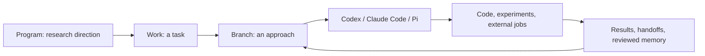

# Orbitree

**English** | [简体中文](README.zh-CN.md)

> A self-hosted workspace for AI-assisted research and engineering.

Keep tasks, agent sessions, workspaces, experiments, and results connected—even when your work branches into multiple ideas.

Orbitree organizes work performed with **Codex**, **Claude Code**, and optionally **Pi**. Use their native terminal interfaces or continue a conversation in the browser, then return to a persistent work tree to see what happened and where to pick up next.

## Why Orbitree?

Working with several AI sessions quickly raises questions: Which conversation owns this experiment? Where did this branch come from? Has the agent finished, or is an external job still running? What did we learn that is worth keeping?

Orbitree gives those pieces a shared structure:



It is an execution workspace, not a news collector or a replacement for your agent's native CLI. Ordinary messages and Goal objectives are forwarded without automatically injecting platform instructions, briefs, or memory. Explicit cross-runtime handoffs are a separate, user-approved action.

## Features

| Capability | What it does | Important boundary |
| --- | --- | --- |
| **Work trees** | Organize directions, tasks, and explicit forks; switch between graph and list views. | Forking is manual. Hiding a task does not delete its files. |
| **Low-friction task creation** | Start scratch work before you have a title or a fully defined objective. | Add detail as the task becomes clearer. |
| **Native CLI + browser conversations** | Start or resume a branch locally, or send a turn from its Results page. | One writer per conversation; independent branches can run concurrently. |
| **Session discovery** | Discover identifiable local Codex sessions and attach them to a task or direction. | Internal subagents are not presented as separate work sessions; ambiguous process bindings are not guessed. |
| **Independent workspaces** | Use registered Git repositories and worktrees, or standalone scratch Git repositories. | Large models, caches, and external data are not automatically duplicated. |
| **Results and live activity** | Review recorded queries, final answers, visible updates, tool activity, and failures. | Runtime event support varies. Hidden model reasoning is not displayed. |
| **Branch-level execution settings** | Select identity, model, and reasoning effort where supported by the chosen runtime. | Authentication and model access must be configured; failures do not silently switch billing identities. |
| **Scheduled checks** | Periodically send an editable check prompt with interval, stop, and notification settings. | Waiting uses no model process; each actual check consumes model quota. Busy conversations defer checks. |
| **Codex Native Goals** | Set a persistent objective and inspect execution, recovery, and goal history. | Codex only. An active Goal is not proof that a model turn is currently running. |
| **Notifications** | Link back to the task after a completed turn, error, Goal progress, or important check result. | Requires configured Infoflow/Ruliu credentials and a recipient. |
| **Handoffs, memory, and skills** | Save conclusions, review evidence-backed memory, and optionally propose new or merged skills. | Handoffs are on demand. Skill proposals require explicit review before installation. |
| **Daily reflections** | Review recorded work in a separate, read-only analysis run. | Opt-in; unregistered work is a coverage limitation, not evidence that nothing happened. |
| **External jobs and evaluation** | Register jobs and use optional evaluation, LTP monitoring, and resource integrations. | These require their own services and credentials; arbitrary jobs are not automatically discovered. |
| **Browser terminal** | Use one independent host shell from the browser. | Requires authentication and explicit enablement in single-user deployments; it is not an AI conversation. |
| **Team deployment** | Invite users into separate Linux execution accounts, instances, databases, and runtime homes. | Separate deployment required; not VM isolation or a complete enterprise SaaS. |
| **On-demand workflow links** | Show workflow visualizations published through a skill or another explicit producer. | Displaying a DAG does not execute or supervise its nodes. |

See the [detailed feature guide](research-ops/README.md#功能导航) for configuration and operating boundaries.

## Screenshots

### Work tree

A Program view shows tasks and user-created forks. The task itself is the default work path; extra nodes represent explicit branches.


### Conversation results

Keep the query and answer together, inspect visible activity, and continue locally or in the browser.


Both screenshots use fictional tasks and conversations, rendered without contacting a production backend. They show the current interface, which still contains some Chinese labels; this README is not a claim of full UI localization.

## Quick start

### Prerequisites

- Python **3.12+** and `uv`.
- Git and Node.js/npm. The current Vite dependency requires Node.js **20.19+ within the 20.x line**, or **22.12+**.
- A configured `codex` CLI. The current host installer checks for it even if you plan to add another runtime.
- Optional: installed and authenticated Claude Code or Pi CLIs.

The core workspace runs directly on the host. **Docker is not required** for this setup; some optional evaluation backends use containers or Kubernetes.

### Install and start

```bash
git clone https://github.com/samaritan1998/orbitree.git
cd orbitree/research-ops
cp .env.example .env
```

Review `.env` before starting: choose models available to your account, configure the runtime identity, and select a writable workspace root. Example integration URLs are placeholders, not working services.

```bash
scripts/install-host.sh --no-service
.venv/bin/rops server start
```

Open **http://127.0.0.1:8020** on the host. For remote access, configure HTTPS, authentication, and a WebSocket-capable reverse proxy. Do not expose an unauthenticated instance with file and shell access to the internet.

Omit `--no-service` to let the installer start a user-level systemd service, or a detached supervisor when user systemd is unavailable.

### A typical workflow

1. Choose a Program, or use **Create scratch work** for an idea that is not yet well defined.
2. Send a message in **Results**, or use **Start locally / Continue locally** and run the copied command on the same host.
3. When you want to try a separate approach, explicitly **Fork**. The parent remains available.
4. Register external experiments in **Jobs**. Use a scheduled check when you only need periodic updates, rather than an ongoing Goal.
5. Return through the work tree or a notification link to review results and continue.
6. Save a handoff when useful, review durable memory, and optionally extract a reusable skill for approval.

Use a **Native Goal** when you want Codex to keep advancing an explicit objective. Use a **scheduled check** when you want a periodic turn while waiting for an external process. Pausing either is not, by itself, cancellation of an external job.

## Programs are configurable

The seed configuration includes these example directions:

| Code | Example scope |
| --- | --- |
| `HARN` | Office automation, presentation tasks, and evaluation harnesses. |
| `COST` | Low-precision training, MoE optimization, and training/inference costs. |
| `ADAPT` | Model architecture support, checkpoint conversion, evaluation, and deployment. |
| `COMMON` | Shared tooling, data, and infrastructure. |
| `FREE` | Unclassified ideas and exploratory work. |

Manage Programs in **Settings**. New team users start with `FREE` and can create their own directions; they do not inherit another user's task tree.

## Documentation

Some guides are currently available only in Chinese; their language is marked below.

| Topic | Guide |
| --- | --- |
| Setup, CLI, and integrations | [Technical README](research-ops/README.md) — mixed English/Chinese |
| Everyday workflow | [Quick start](docs/QUICKSTART.zh-CN.md), [User guide](research-ops/docs/USER_GUIDE.zh-CN.md) — Chinese |
| Identity and account selection | [Identity switching](research-ops/docs/identity-switching.md) |
| Additional runtimes | [Claude Code](research-ops/docs/CLAUDE_RUNTIME.md), [Pi](research-ops/docs/PI_RUNTIME.md) |
| Periodic checks | [Scheduled checks](research-ops/docs/scheduled-checks.md) |
| Persistent objectives | [Native Goal](research-ops/docs/NATIVE_GOAL.zh-CN.md) — Chinese |
| Browser shell | [Web terminal](research-ops/docs/web-terminal.md) |
| Multiple users | [Team deployment](research-ops/docs/team-mode.md) — Chinese |
| Evaluation | [Agent Eval Harness](research-ops/docs/AGENT_EVAL_HARNESS.md) |
| Workflow visualization | [On-demand workflows](research-ops/docs/session-workflows.md) |
| Recovery | [Recovery guide](research-ops/RECOVERY.md) |
| Sanitized release configuration | [Public release checks](docs/PUBLIC_RELEASE.zh-CN.md) — Chinese |

## Development

From `research-ops/`:

```bash
uv sync --extra dev
npm --prefix web ci
uv run pytest
uv run ruff check backend tests
npm --prefix web run lint
npm --prefix web test
```

The backend uses FastAPI and SQLAlchemy; the frontend uses React, TypeScript, and Vite.

```text
orbitree/
  README.md                 # English overview
  README.zh-CN.md            # Chinese overview
  research-ops/
    backend/research_ops/    # API, state, runtime adapters, integrations
    web/                     # React workspace
    config/                  # Program seeds and example configuration
    docs/                    # Runtime and operating guides
  docs/                      # Getting started and release guidance
  scripts/                   # Public-release checks
```

**Naming compatibility:** the product is Orbitree, but `research-ops/`, the `research_ops` Python module, the `rops` command, and `ROPS_*` settings retain their existing names.

## Security and deployment boundaries

- **Use your own credentials.** No model logins, API keys, real session transcripts, databases, or private experiment outputs are included.
- **Review permissions before enabling agents.** They run with the configured host user and runtime permissions. In particular, the example Claude configuration uses `bypassPermissions`; change it if that is not appropriate for your environment.
- **Configure integrations explicitly.** LTP, AgentOS/Datawheel, Goblin, Octo, OneAPI, and notifications are adapters, not bundled hosted services or access grants.
- **Treat team mode as a separate deployment.** It uses per-user accounts and filesystem restrictions, but does not protect users from the host administrator or provide VM-level isolation. Enterprise SSO, resource quotas, and cross-user shared projects are not implemented.
- **Do not equate agent status with job status.** A completed conversation can leave an external job running; an active Goal can be waiting or disconnected.
- **Keep runtime data out of Git.** `.env`, credentials, database files, session JSONL, logs, model weights, experiment artifacts, and private LTP bundles must remain local. Review staged files and scan for secrets before publishing changes.

## License and third-party assets

A project-wide open-source license has **not yet been selected**. The source is publicly available, but this README does not grant an additional license; check the repository's licensing status before adoption or redistribution.

Background images retain their original licenses and attribution. See [theme asset sources](research-ops/web/public/themes/README.md).
