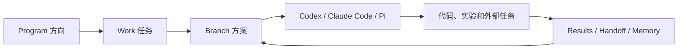
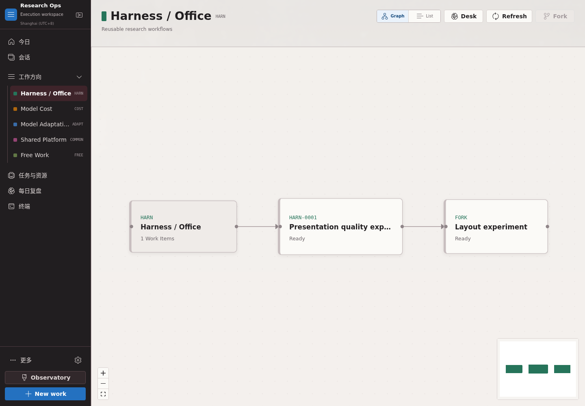
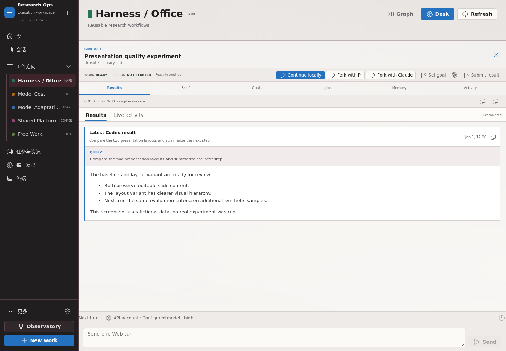

# Orbitree

[English](README.md) | **简体中文**

> A self-hosted workspace for AI-assisted research and engineering.

面向模型研究工作的本地优先执行工作台。Orbitree 管理方向、任务、分支、Codex/Claude Code/Pi 会话、工作目录、外部任务和结果，让一项工作可以继续、分叉和回看。本仓库只维护 Orbitree；不包含技术情报采集系统。

公开产品名称为 **Orbitree**。为保持现有部署兼容，源码目录 `research-ops/`、Python 模块 `research_ops`、CLI 命令 `rops` 和配置前缀 `ROPS_*` 保留原名。



## Orbitree 功能一览

| 工作环节 | 功能 | 入口或说明 |
| --- | --- | --- |
| 开始工作 | 无需先写目标的临时任务、可配置方向、任务树与 Graph/List 视图 | `/today`、`/programs/CODE` |
| 执行与继续 | Web 单轮对话、本地 CLI、会话发现与挂载、手动 Fork、按 Branch 选择模型和身份 | `Results`、`/sessions`；支持 Codex、Claude Code，可选 Pi |
| 保持进度 | 可见活动、最终结果、Handoff、已审核 Memory、候选 Skill、分支结果合并 | Branch 详情、`/memory`、`/skills`、`/merge` |
| 等待与检查 | 定时检查、Codex Native Goal、每日复盘、如流通知 | 需要分别启用；Native Goal 仅适用于 Codex Branch |
| 评测与资源 | Agent Eval Harness、LTP 任务监控、只读集群资源视图 | `/evals`、`/ltp-monitor`、`/clusters`；依赖对应外部服务 |
| 管理与扩展 | 浏览器终端、仓库、多人账号与个人方向 | `/terminal`、`/repositories`、`/settings`；多人入口单独部署 |

Orbitree 的[完整功能导航与边界](research-ops/README.md#功能导航)列出了哪些功能默认可用、哪些需要额外配置。系统不自动替用户创建 Fork，也不向普通对话注入平台提示词。

## 适用方向

现有单人实例使用下列方向；多人部署中的新账号默认只有 FREE，可以在「设置 → 工作方向」自行新增：

| Program | 典型工作 |
| --- | --- |
| `HARN` | PPT 轨迹、PresentBench、Office Agent、秒哒泛化 Harness |
| `COST` | 低精度训练、FP8/FP4、MoE 专家裁剪、训练与推理降本 |
| `ADAPT` | 新模型结构适配、权重转换、训练、评测、上线 |
| `COMMON` | 跨方向复用的评测、数据、工具和基础设施 |
| `FREE` | 尚未归类的想法、临时验证和探索 |

## 截图

Orbitree 的 Program 图展示工作项和显式 fork 的关系。图中的节点只表示用户选择保留的工作路径；Codex 内部 subagent 不会把页面淹没。



在一个任务内，Web 显示可见进度、已完成轮次的结果、外部任务、Handoff 与 Memory；原生本地终端保留对应 AI CLI 的完整交互能力。



截图使用虚构任务、会话和运行记录生成，不连接实际后端。

## 快速开始

### 1. 安装与启动

```bash
git clone https://github.com/samaritan1998/orbitree.git
cd orbitree/research-ops
cp .env.example .env
scripts/install-host.sh --no-service
.venv/bin/rops server start
```

默认启动地址为 `http://127.0.0.1:8020`。它不要求 Docker；本地数据库、工作目录和 Codex 会话均留在宿主机。

### 2. 日常工作流

1. 在 Orbitree 选择方向；想法还不清楚时使用 `Create scratch work`，明确时使用 `New work`。
2. 在任务详情直接发起一轮 Web 对话，或点击 `Start locally` / `Continue locally`，将命令粘贴到同一台服务器的终端。
3. 在所选的 Codex、Claude Code 或 Pi 中完成调试、代码、训练、部署或评测。Web 汇总可见进度和已完成轮次的结果；同步时机因运行时而异。
4. 有独立假设时显式 `Fork`；新的目标则创建 Work，不要求为每个想法分叉。
5. 一轮结束后按需保存 Handoff；可选择提取候选 Skill，人工审核后才安装。

完整操作说明见 [快速上手](docs/QUICKSTART.zh-CN.md) 和 [Orbitree 使用手册](research-ops/docs/USER_GUIDE.zh-CN.md)。

## 仓库结构

```text
orbitree/
  research-ops/    # 研究执行、会话和工作树管理
  docs/            # 快速上手
```

Orbitree 的依赖和启动命令在其子目录中。进一步阅读：

- [Orbitree README](research-ops/README.md)
- [Orbitree 功能说明与文档索引](research-ops/README.md#文档索引)

## 安全与备份范围

这个仓库只保存源码、示例配置、文档与脱敏截图。以下内容必须留在本地，且由 `.gitignore` 排除：

- `.env`、API Key、Token、证书和私有凭据
- SQLite/数据库文件、Codex 会话 JSONL、运行日志
- 模型权重、训练输出、评测结果、外部服务导出
- `research-ops/deploy/ltp/` 下的实验任务配置和运行回执
- Python/Node 依赖目录和前端构建产物

提交前应对暂存文件做密钥扫描，并运行 `git diff --cached --check` 和变更清单复核。示例地址、外部集成和历史检查说明见 [公开版配置与发布检查](docs/PUBLIC_RELEASE.zh-CN.md)。
