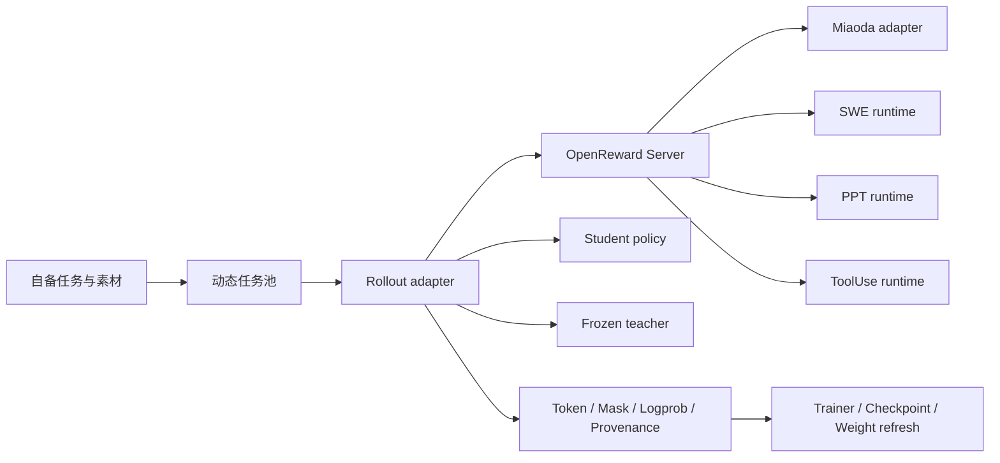

# 四域 OpenReward 在线训练：公开版集成说明

本文说明 Miaoda、SWE、PPT 和 ToolUse 的统一环境接口，以及轨迹到训练样本的集成方式。原部署的任务身份、私有数据规模、实验结果和运行回执不随公开版分发。示例不是已完成实验的证明。

## 组件关系

ORS 提供按域路由的统一接口。Orbitree 的会话、外部任务与结果管理是控制面，不替代训练框架、评测服务或集群调度器。

## 数据与服务前置条件

真实运行前，需要自行提供：

1. 每个域的任务输入、授权使用的素材和验证器。
2. Student 与 teacher 的模型产物、tokenizer 和模板。
3. 可访问的推理服务、训练环境，以及所选 runtime 依赖。
4. 通过环境变量或 Secret 引用注入的凭据。
5. 任务隔离、停止、清理和失败恢复策略。

`config/openreward-four-domain-dynamic-sources.json` 展示来源清单的结构。应用与 PPT 的公开任务池已改成合成样例，不包含原始 query、应用 ID、评分或私有素材。SWE 与 ToolUse 样例包含上游公开任务的协议；复用数据时仍需遵守对应上游许可。

## 统一环境协议

训练 adapter 不应拼接 verifier 信息到 policy prompt。任务说明和允许的工具交给 student；评分用的数据保留在服务端。

统一 backend 的动作包括：

- `reset`：创建隔离 episode，返回初始观察和工具说明。
- `step`：执行一个允许的动作，返回观察、reward 和终止状态。
- `close`：释放 episode 的临时资源。

接口的实际 HTTP 路由、类型与错误处理以 `backend/research_ops/openreward` 为准。可先通过 mock backend 验证客户端，不需要真实集群或外部账号。

### 应用域

AgentOS/Datawheel 是可选远端集成，不随仓库提供。显式批次使用 `optimizer_batch_id` 与实际 `expected_count` 标识同一训练批，episode 仍保持独立身份。服务应校验模型 timeout 与消息间隔 timeout 的关系，避免正常长生成被上游提前终止。

Policy HTTP capture、远端 trajectory 与训练样本必须按 episode 和 attempt 关联。不能把不同重试混成同一次轨迹，也不能以缺失 logprob 的零值冒充有效证据。

### SWE 域

SWE runtime 负责固定代码版本、隔离工作区和测试验证。任务 spec 包含 repo、commit、镜像与 verifier；student 只得到任务说明和工具访问。容器、Kubernetes 和 harness 需要部署者自行配置。

### PPT 域

PPT 任务需要可恢复的素材 bundle，不能仅凭历史轨迹重建输入。参考材料、风格样例与待编辑文稿应分清角色。验证器可检查可编辑性、内容约束、渲染与视觉质量；输出路径应受工作区约束。

公开样例指向 `/inputs/reference.md`，需要部署者自行创建该文件。它不含原部署的参考文档、演示文稿、评分或素材哈希。

### ToolUse 域

任务绑定工具服务目录、隔离状态与 evaluator。执行结果和评分应通过明确的 terminal action 收集，不以模型的「已完成」声明替代运行证据。

## 轨迹到训练样本

Sample 应保留生成顺序、token IDs、loss mask、behavior logprob、teacher logprob、episode/group identity 与 student weight version。

Teacher 对 student 已生成的同一 token 序列打分，不另生成一份回答。需要分别确认：

- behavior logprob 属于实际产生轨迹的 policy 版本。
- teacher logprob 与该轨迹 token 对齐，且数值有限。
- optimizer 使用的 token、mask 和 provenance 能追溯到同一 attempt。

刷新 student 权重后，新一批轨迹应记录新的 weight version。不能用过期 endpoint 或旧 readiness 文件证明当前服务可用。

## Checkpoint 与恢复

Endpoint 是运行时产物，不应当作长期任务身份。恢复时应核对 checkpoint lineage、tokenizer、模板、route receipt、weight version 和任务池 cursor。

对未知结果的外部提交，先核验回执与远端状态，再决定是否重试。不能因为本地连接断开就直接重复提交。清理资源前，应确认资源确实属于本次运行，且不再被后续步骤使用。

## 验收与可观测性

建议按以下顺序建立证据：

1. 用 mock backend 验证客户端协议与失败处理。
2. 每个真实域分别完成小规模 canary，确认输入、工具、终止与评分。
3. 核对 trajectory 与 token/logprob capture 的一一关联。
4. 完成一次 optimizer update，确认有限 loss/gradient 与完整 checkpoint。
5. 刷新权重并验证下一批样本确实使用新版本。
6. 在目标资源与上下文条件下验证吞吐、恢复和清理。

结果记录应包含配置摘要、任务回执、attempt、输入/输出哈希、错误根因和证据路径。代码就绪、提交成功、任务开始和训练完成是不同状态；应分别报告。

## 代码与配置入口

| 用途 | 入口 |
| --- | --- |
| 统一服务与各域 backend | `backend/research_ops/openreward/` |
| Backend 示例配置 | `config/openreward-backends.example.yaml` |
| 通用任务示例 | `config/openreward-tasks.example.yaml` |
| 动态来源示例 | `config/openreward-four-domain-dynamic-sources.json` |
| Teacher 路由示例 | `config/openreward-four-domain-teacher-routing.yaml` |
| 循环驱动示例 | `scripts/run_openreward_mopd_cycle.py` |
| 运行时说明 | `docs/OPENREWARD_INTEGRATION.md`、`docs/OPENREWARD_PPT_RUNTIME.md` |

历史部署 bundle、checkpoint、运行回执和私有集群配置不分发。涉及这些产物的脚本需先配置自己的输入和服务，不应直接按示例路径提交任务。
